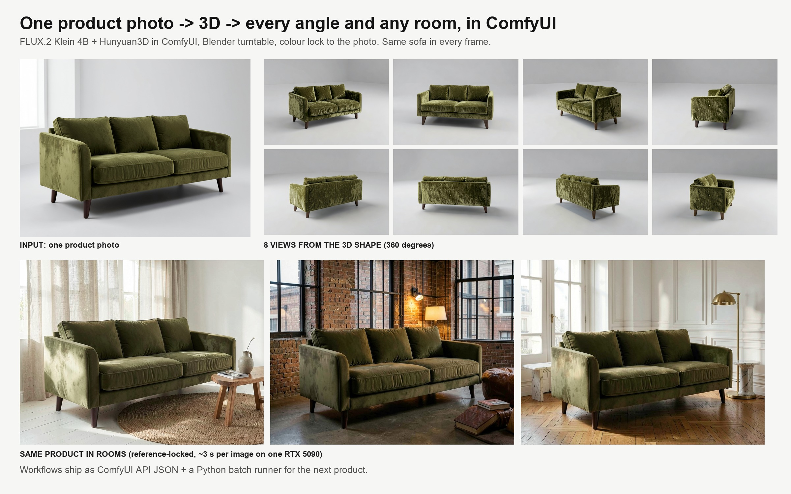

# comfy-product-studio



One product photo in, a consistent set of marketing images out: every angle around the product and the same product
in any room. Built as ComfyUI workflows (API JSON in `workflows/`) driven by a small Python batch runner, on one
RTX 5090. Made as a showcase for furniture and product-imagery work.

## Pipeline
| Step | Tool | Script | Output |
|---|---|---|---|
| 1 | Mask2Former (ADE20K) | `scripts/cutout.py` | product cut-out (RGBA) |
| 2 | — | `scripts/prep_for_3d.py` | product on pure white, square crop |
| 3 | **Hunyuan3D 2.0 in ComfyUI** | `scripts/shape3d.py` | 3D shape `.glb` (geometry only), ~40 s |
| 4 | Blender 5.2 | `scripts/turntable.py` | 8 clay views around the product |
| 5 | **FLUX.2 Klein 4B in ComfyUI**, ReferenceLatent | `scripts/views.py clay_only` | photoreal view per angle, ~4 s each |
| 6 | LAB colour transfer | `scripts/colour_lock.py` | every view locked to the photo's upholstery colour |
| 7 | **FLUX.2 Klein in ComfyUI**, product photo as reference | `scripts/scenes.py` | same product in rooms, ~3 s each |

`studio/server.py` starts a headless ComfyUI on its own port, queues the graphs, copies results and always shuts
the server down (the GPU is returned on every exit path). `studio/workflows.py` builds the graphs; the same graphs
are saved as `workflows/*.api.json` and can be loaded in ComfyUI by hand.

## What I learned building it (and what did not work)
- Hunyuan3D needs the product on **pure white, cropped**; feeding a soft alpha mask produced a phantom wall slab
  and a shadow plate in the mesh.
- Giving FLUX.2 Klein **both** the clay view and the product photo as references makes it copy the photo and
  ignore the angle (all 8 views came out identical). Clay view alone + the material in words keeps the angle exactly.
- Text alone drifts the colour, so a deterministic colour-lock step brings each view back to the photo.
- Known limit: the velvet texture on the side and back views is busier than on the photo; a texture-baking stage
  (Hunyuan3D paint) is the next step for exact fabric detail.

## Run
```
py -3.14 scripts/smoke.py                                    # product photo (or use your own photo)
py -3.14 scripts/cutout.py renders/smoke/sofa_seed7.png sofa input/sofa_rgba.png
py -3.14 scripts/prep_for_3d.py input/sofa_rgba.png input/sofa_white.png
py -3.14 scripts/shape3d.py input/sofa_white.png sofa_w
blender -b -P scripts/turntable.py -- output/3d/sofa_w_00001_.glb renders/turntable 8
py -3.14 scripts/views.py renders/smoke/sofa_seed7.png renders/turntable clay_only
py -3.14 scripts/colour_lock.py input/sofa_rgba.png renders/views_clay_only renders/views_locked
py -3.14 scripts/scenes.py renders/smoke/sofa_seed7.png
py -3.14 scripts/cover.py
```
Models: FLUX.2 Klein 4B (`flux-2-klein-4b.safetensors`, `qwen_3_4b.safetensors`, `flux2-vae.safetensors` from
Comfy-Org), Hunyuan3D-2 via ComfyUI-Hunyuan3DWrapper. Paths in `extra_model_paths.yaml`.
The sofa is a generated product, not a real brand.
